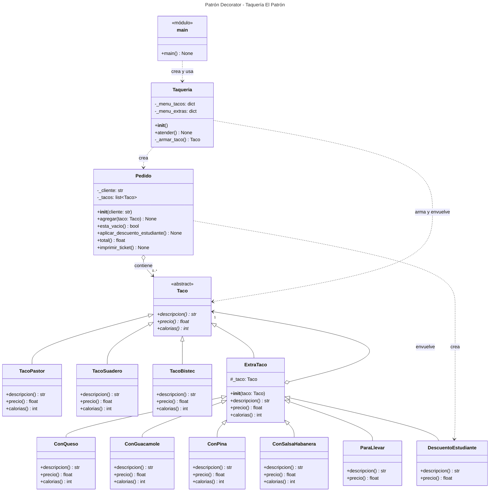

# Diagrama de clases · Decorator (Taquería El Patrón)

## Cómo leerlo

| Símbolo | Significado |
|---|---|
| `<<abstract>>` y métodos con `*` | Clase abstracta y métodos abstractos (`ABC` y `@abstractmethod`) |
| `+` / `-` / `#` | Público / privado / protegido (en Python, `_` al inicio indica "interno") |
| Flecha con triángulo hueco | Herencia: "es un" |
| Flecha con rombo hueco | Agregación: "tiene un" |
| Flecha punteada | Dependencia: "usa" o "crea" |

**Lo importante del patrón:** `ExtraTaco` **hereda** de `Taco` (es un Taco) y al mismo tiempo **tiene** un `Taco` adentro (`_taco`). Esa doble relación entre las mismas dos clases es la firma del Decorator.

`Taqueria._armar_taco()` devuelve `Taco | None` (un taco, o nada si la opción no fue válida).

`ParaLlevar` y `DescuentoEstudiante` no sobrescriben `calorias()`: usan la versión de `ExtraTaco`, que solo le pasa la pregunta al taco de adentro.
